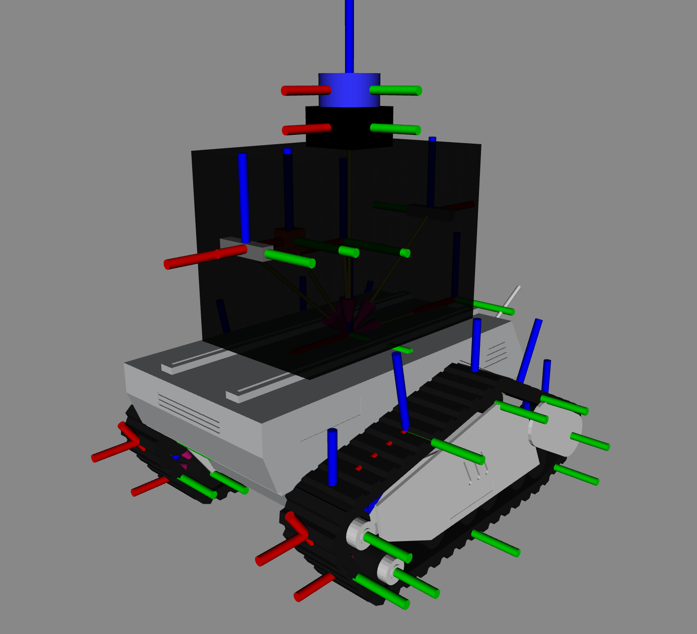

# Jo Description

A comprehensive ROS 2 robot description package for the Jo tracked robot platform, featuring complete robot modeling, and simulated sensors.

<div align="center">
  
</div>


## Building
 
```bash
cd ~/ros2_ws
colcon build --packages-select jo_description
source install/setup.bash
```
 
## Usage
 
### Launch only Robot State Publisher
 
```bash
ros2 launch jo_description description.launch.py
```

### Launch with RViz
```bash
ros2 launch jo_description description.launch.py use_rviz:=true
```


## Robot model

All geometry comes from `BUNKER_PRO2_rack_sensori_ASSIEME_2.step`: the AgileX Bunker Pro 2.0
(body, tracks, track collision shapes), the rack EWT-2406BK and the sensors. Sensor frames
come from the axis triads (`TERNA - *`) in the assembly.

| Frame               | Where                                                                    |
|---------------------|--------------------------------------------------------------------------|
| `base_link`         | top deck of the body (under the rails), longitudinal centre of the upper shell |
| `base_footprint`    | ground, 0.454 m below `base_link`                                        |
| `chassis`           | rear top edge of the upper shell                                         |
| `rack`              | centre of the rack                                                       |
| `velodyne`          | VLP-16 optical centre (37.7 mm above its base)                           |
| `imu_link`          | MTi-680G housing centre, X forward (as printed on the IMU; the CAD triad orientation is wrong) |
| `front_camera_link`, `back_camera_link` | D456 `camera_link` convention: left IR imager (depth origin), X out of the lens |

CAD values are kept in the CAD frame (origin on the ground at the longitudinal centre of
the tracks) and converted with `cad2base_x` / `cad2base_z` in `urdf/robot_core.xacro`.

### Regenerating the meshes

```bash
pip install cadquery-ocp numpy trimesh fast_simplification
python3 scripts/step_to_meshes.py BUNKER_PRO2_rack_sensori_ASSIEME_2.step meshes/
```

The script also prints the sensor frames w.r.t. `base_link`, to copy into the xacro files
if the assembly changes. Robot and rack meshes are in the CAD frame; sensor meshes are in
their sensor frame.

### Gazebo

Track links (`back_*_roller`, `front_*_roller`, `*_bottom_belt`, `*_back_bottom_belt`,
`*_front_bottom_belt`) are driven by `TrackController`/`TrackedVehicle`. Their frames are
axis-aligned with `base_link`. Meshes use `package://` URIs; the package installs an
environment hook that adds its `share` directory to `GZ_SIM_RESOURCE_PATH`.

## Package Structure
 
```
jo_description/
├── BUNKER_PRO2_rack_sensori_ASSIEME_2.step # Robot + platform CAD (source of the meshes)
├── CMakeLists.txt
├── hooks
│   └── jo_description.dsv.in               # GZ_SIM_RESOURCE_PATH hook
├── launch
│   └── description.launch.py
├── meshes                                  # Visual meshes generated from the STEP
├── package.xml
├── README.md
├── res
│   └── description.png
├── rviz
│   └── display.rviz
├── scripts
│   └── step_to_meshes.py                   # STEP -> STL converter
└── urdf
    ├── d456.xacro                          # Simulated D456 (front and back)
    ├── imu.xacro                           # Simulated IMU (MTi-680G)
    ├── inertial_macros.xacro              
    ├── jo_main.urdf.xacro                  # Main xacro file
    ├── robot_core.xacro                    # Robot's body + rack
    ├── track.xacro                         # Tracks (geometry from CAD) + Gazebo track plugins
    └── velodyne.xacro                      # Simulated lidar (VLP-16) + its support

```
